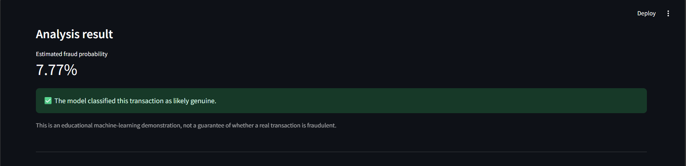
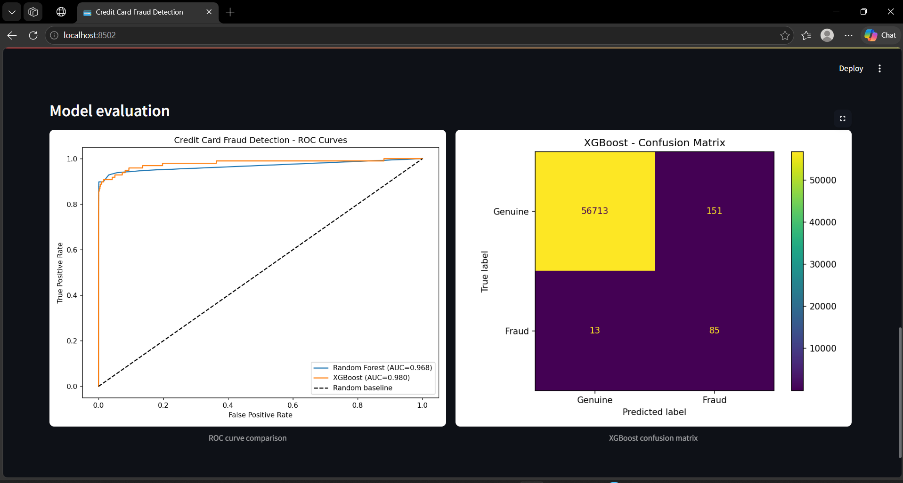
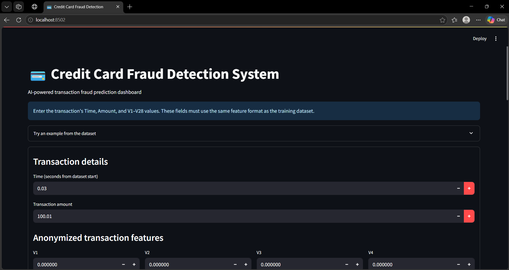
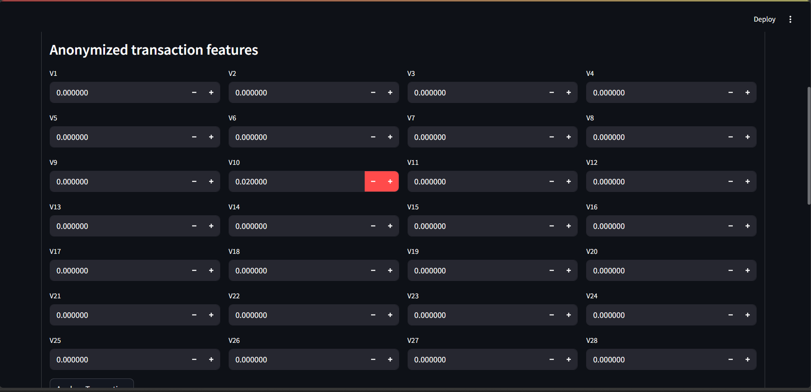

# Credit Card Fraud Detection System

An educational machine-learning project for detecting potentially fraudulent credit-card transactions using Random Forest, XGBoost, and anomaly-detection models.

## Dashboard Screenshots

The Streamlit dashboard lets users enter transaction features, view a fraud probability estimate, and review model evaluation charts.

### 1. Fraud Prediction Result


### 2. Model Evaluation Dashboard


### 3. Transaction Input Dashboard


### 4. Transaction Features Form


## Tech Stack
- Python
- Pandas
- Scikit-learn
- XGBoost
- imbalanced-learn (SMOTE)
- Streamlit
- Matplotlib
- Joblib

## Run Locally
Install the dependencies listed in `requirements.txt`, then train the models:

```bash
python advanced_fraud_detection.py
```

Launch the dashboard:

```bash
streamlit run app.py
```

## Dataset
This project uses the Kaggle Credit Card Fraud Detection dataset. Place `creditcard.csv` at `dataset/creditcard.csv` before training. Do not commit the dataset or trained model artifacts to a public repository unless you have checked their licensing and repository-size implications.

## Note
This is an educational demonstration. Model outputs are not a guarantee that a real transaction is fraudulent or genuine.
